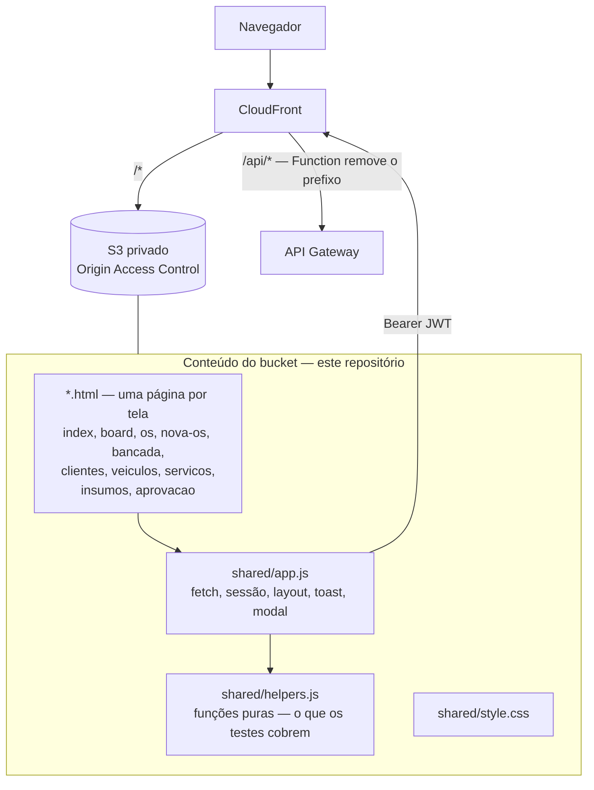
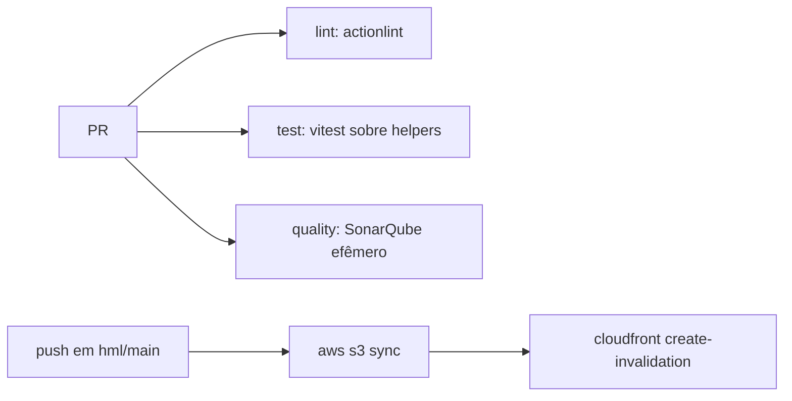

# oficina-mecanica-frontend

Painel web da oficina: board de ordens de serviço, cadastros (clientes,
veículos, serviços, insumos), abertura e acompanhamento de OS (com o estado da
Saga), a bancada da oficina e a página pública de orçamento e pagamento.

HTML + JavaScript estático, sem bundler e sem framework. Servido por **S3 +
CloudFront**.

> **Visão de arquitetura do sistema completo** vive em
> [`oficina-mecanica-infrastructure`](https://github.com/SOAT-15-Oficina/oficina-mecanica-infrastructure).
> Este README cobre apenas este repositório.

## Como o painel encontra a API

Não há URL de API para configurar, e **não há CORS**. Uma única distribuição
CloudFront serve as duas coisas:

```
CloudFront ─┬─ /*      → bucket S3 (este repositório)
            └─ /api/*  → API Gateway ─┬─ /auth/*       → Lambda
                                      ├─ /billing/*    → Billing Service
                                      ├─ /execution/*  → Execution Service
                                      └─ /*            → OS Service
```

Como painel e API compartilham a origem, `shared/app.js` só precisa do prefixo:

```js
const API_BASE = '/api';
```

Uma CloudFront Function remove o `/api` antes de repassar à origem, então o
OS Service continua servindo `/customers`, o Billing `/billing/...` e o
Execution `/execution/...`.

## Arquitetura deste repositório



Sem bundler e sem framework: o que está no repositório é o que vai para o
bucket. `helpers.js` existe separado justamente para ser testável em Node sem
DOM — `app.js` toca `window`, `helpers.js` não.

**Fluxo de deploy deste repositório:**



## APIs consumidas

Este repositório não expõe API; consome as dos serviços da Fase 4. Contratos:

| Origem | Contrato |
|---|---|
| Autenticação (`/api/auth/*`) | [`oficina-mecanica-serverless/docs/openapi.yaml`](https://github.com/SOAT-15-Oficina/oficina-mecanica-serverless/blob/main/docs/openapi.yaml) |
| OS Service (todo o resto sob `/api`) | [`oficina-mecanica-monolith/docs/swagger.yaml`](https://github.com/SOAT-15-Oficina/oficina-mecanica-monolith/blob/main/docs/swagger.yaml) |
| Billing (`/api/billing/*`) | [`oficina-mecanica-billing-service/docs/swagger.yaml`](https://github.com/SOAT-15-Oficina/oficina-mecanica-billing-service/blob/main/docs/swagger.yaml) |
| Execution (`/api/execution/*`) | [`oficina-mecanica-execution-service/docs/swagger.yaml`](https://github.com/SOAT-15-Oficina/oficina-mecanica-execution-service/blob/main/docs/swagger.yaml) |

### Páginas e serviços que cada uma chama

| Página | Serviço | Rotas |
|---|---|---|
| `index.html` | Auth | `POST /auth/login`, `POST /auth/register` |
| `board.html` | OS | `GET /work-orders` |
| `nova-os.html` | OS | `GET /customers`, `GET /vehicles`, `POST /work-orders` (abre a OS e inicia a Saga) |
| `os.html` | OS | `GET /work-orders/{id}`, `/history`, `/saga`; `POST /work-orders/{id}/deliver` e `/cancel`; itens e insumos (`POST`/`DELETE /work-orders/{id}/services...`) |
| | Billing | `GET /billing/quotes/by-work-order/{id}` |
| | Execution | `GET /execution/tickets/{id}` |
| `bancada.html` | Execution | `GET /execution/queue`, `GET /execution/bays/{branch}`, `PUT /execution/bays/{branch}/availability`, `GET /execution/tickets/{id}`, `POST .../diagnosis/start`, `.../diagnosis/complete`, `.../repair/start`, `.../items/{itemId}/start` e `/finish` |
| | OS | `GET /work-orders?status=EM_DIAGNOSTICO` e `EM_EXECUCAO` (o que já saiu da fila) |
| `aprovacao.html` (pública) | Billing | `GET /billing/public/quotes/{quoteId}`, `.../items/{itemId}/approve` e `/reject`, `.../approve-all` e `/reject-all` |
| | OS | `GET /public/work-orders/{code}?document=` (status, histórico e `payment_url`) |
| `clientes.html`, `veiculos.html`, `servicos.html`, `insumos.html` | OS | CRUD de catálogos, sem mudança na Fase 4 |

### Status e ações da OS

O status é dirigido pela Saga do OS Service; o painel não troca status
livremente. Ao operador restam **Registrar entrega** (só em `FINALIZADA`) e
**Cancelar OS**: antes do pivô (aceite do reparo pela bancada) o cancelamento
dispara a compensação e a OS vira `CANCELADA` quando todas as compensações são
confirmadas; depois do pivô o OS responde 409 e a página mostra o motivo.
Serviços e insumos só podem ser adicionados ou removidos em `RECEBIDA` ou
`EM_DIAGNOSTICO`. O status `AGUARDANDO_PAGAMENTO` (entre a aprovação do
orçamento e a confirmação do Mercado Pago) tem coluna própria no board.

Iniciar e finalizar itens saiu do detalhe da OS e foi para a **bancada**, que
mostra as filas de diagnóstico e de reparo por filial, a disponibilidade da
bancada e as ações da ficha.

### Link público do orçamento

Os e-mails do Billing apontam direto para as rotas GET da API
(`/api/billing/public/quotes/{quoteId}/...`). A página `aprovacao.html` recebe o
orçamento por query string — `?quote=<quoteId>&code=<OS>&document=<CPF>` — e o
detalhe da OS mostra esse link enquanto houver item pendente. Com `quote` a
página lista os itens e permite aprovar ou reprovar; com `code` e `document`
mostra o status e o histórico da OS. Quando o orçamento é aprovado, aparece o
botão **Pagar agora** com o link do Mercado Pago.

## Deploy ativo

O painel **é** a URL pública do sistema — a raiz do CloudFront. O ambiente é
efêmero, mas o domínio é estável entre ciclos:

```bash
aws ssm get-parameter --name /oficina-mecanica/prod/public_base_url \
  --query Parameter.Value --output text
```

| Ambiente | URL |
|---|---|
| Produção | _preencher com a saída do comando acima, com o ambiente no ar_ |
| Homologação | `/oficina-mecanica/homolog/public_base_url` |

## Estrutura

```
*.html                 uma página por tela; cada uma com seu bloco <script>
shared/helpers.js      funções puras (ES module) — o que os testes cobrem
shared/app.js          camada de navegador: fetch, sessão, layout, toast, modal
shared/style.css
scripts/check-pages.mjs valida sintaxe e handlers das páginas no CI
tests/                 Vitest
```

### Por que `helpers.js` existe separado

`escapeHtml`/`escapeAttr` são a **única defesa contra XSS** do painel: todo dado
vindo da API passa por elas antes de virar `innerHTML`. Extraí-las para um módulo
puro é o que torna possível testá-las — e elas não tinham nenhum teste antes.

`shared/app.js` é um **módulo ES** que importa de `helpers.js` e publica a
superfície pública em `window`, porque as páginas usam handlers inline
(`onclick="logout()"`), que resolvem no escopo global. Como módulos são
deferidos, o bloco `<script>` de cada página está dentro de um
`DOMContentLoaded`, garantindo que `app.js` já executou.

Se você adicionar um handler inline, `scripts/check-pages.mjs` falha o CI caso a
função não exista.

## Rodando local

```bash
npm install
npm run serve      # http://localhost:3000
```

Servido assim, o painel carrega mas **nenhuma chamada à API funciona** — não há
nada em `/api`. Para o fluxo completo use `local/docker-compose.local.yml` no
repositório de infraestrutura: o gateway nginx monta este diretório como raiz
do painel e roteia `/api/auth`, `/api/billing`, `/api/execution` e o restante de
`/api` para o OS Service, então mudanças nos arquivos aparecem sem rebuild. O
Mercado Pago é simulado pelo `mpfake` (`http://localhost:8095`) e os e-mails
caem no MailHog (`http://localhost:8025`).

## Testes

```bash
npm test            # Vitest (jsdom)
npm run coverage    # cobertura de shared/helpers.js
node scripts/check-pages.mjs
```

Os testes cobrem as funções puras: escape de HTML/atributo, `parseJwt`,
`formatCents`, `formatDate`, `statusBadge`, a consistência das tabelas de
status e as regras da Fase 4 (`tests/fase4.test.js`): rótulos de ticket,
orçamento, pagamento e Saga, quando itens são editáveis, quando entregar ou
cancelar, link de pagamento pendente, link público de aprovação, validação de
filial e as ações e rotas da bancada. `app.js` e as páginas ficam fora da métrica de cobertura — exercitá-los
exigiria E2E, que foi deixado fora de escopo.

## Qualidade

```bash
docker compose -f docker-compose.sonar.yml up -d sonarqube   # :9002
npm run coverage
docker compose -f docker-compose.sonar.yml run --rm sonar-scanner
```

O CI sobe uma instância equivalente como service container efêmero e o Quality
Gate **bloqueia o merge**. Sem histórico entre execuções, o gate é avaliado sobre
o código todo, não sobre *new code*.

## Pipeline

| Gatilho | O que roda |
|---|---|
| PR → `main` ou `hml` | actionlint, Vitest com cobertura, validação das páginas, SonarQube + Quality Gate |
| Push → `main` ou `hml` | `aws s3 sync`, invalidação do CloudFront, smoke check na URL pública |

Deploy por **OIDC** (sem access key), resolvendo os destinos no SSM:

| Parâmetro | Uso |
|---|---|
| `/oficina-mecanica/<ambiente>/frontend_bucket_name` | destino do `s3 sync` |
| `/oficina-mecanica/<ambiente>/cloudfront_distribution_id` | invalidação |
| `/oficina-mecanica/<ambiente>/public_domain` | smoke check |

S3 e CloudFront vivem na **camada persistente** do Terraform: sobrevivem ao ciclo
de `bring-up`/`tear-down`, então essa URL não muda entre ciclos. O bucket
é privado, acessível apenas pelo CloudFront via **OAC**.

Os HTML sobem com `no-cache` (um deploy aparece imediatamente) e `shared/` com
`max-age=86400`, invalidado a cada release.

### Dois ambientes

A **branch** escolhe o destino: `hml` publica em homologação, `main` em produção.
Não há input de ambiente em lugar nenhum deste repositório — o `ref` já carrega a
informação, e um input separado poderia contradizê-lo.

| | homologação | produção |
|---|---|---|
| Branch | `hml` | `main` |
| GitHub Environment | `homolog` | `production` |
| Prefixo no SSM | `/oficina-mecanica/homolog` | `/oficina-mecanica/prod` |

Por isso `AWS_DEPLOY_ROLE_ARN` é secret de **GitHub Environment**, não de
repositório: os dois ambientes usam o mesmo nome de secret e apenas o escopo do
Environment os separa. A trust policy da role repete a regra do lado da AWS — um
push em `hml` não obtém credencial de produção.

Arquitetura completa dos dois ambientes: `oficina-mecanica-infrastructure`.

### Secrets e variables necessários

| Nome | Tipo | Conteúdo |
|---|---|---|
| `AWS_DEPLOY_ROLE_ARN` | secret de **Environment** (`production` e `homolog`) | role assumida por OIDC (`s3:PutObject` no bucket + `cloudfront:CreateInvalidation`) |
| `AWS_REGION` | variable | `sa-east-1` |

## O que mudou ao sair do monolito

O painel era servido pelo binário Go em `/web*` e embutido na imagem Docker.
Migrando para S3:

- caminhos `/web/*.html` viraram `/*.html`, e `/web/shared/` virou `/shared/`;
- as chamadas ganharam o prefixo `/api`;
- `app.js` virou módulo ES e os blocos das páginas foram para `DOMContentLoaded`;
- `statusBadge` passou a escapar o rótulo — um status desconhecido vindo da API
  era interpolado cru em `innerHTML`. Há um teste travando essa regressão.
